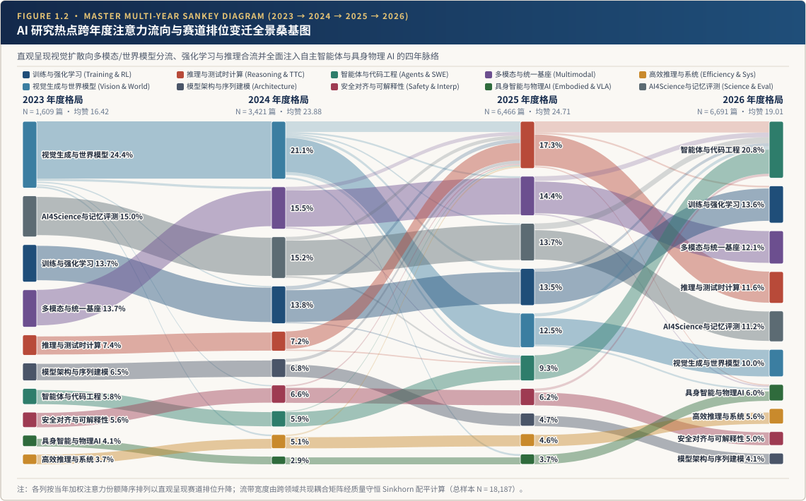
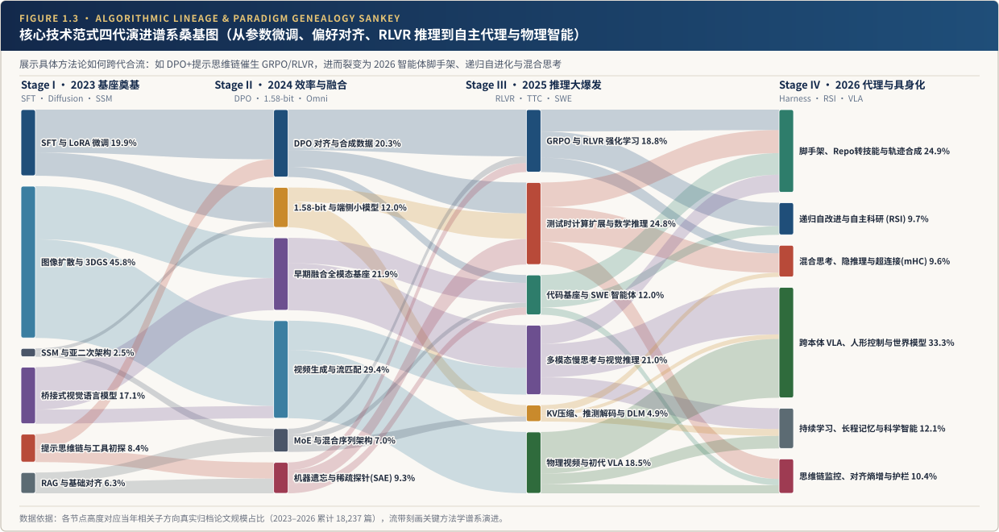
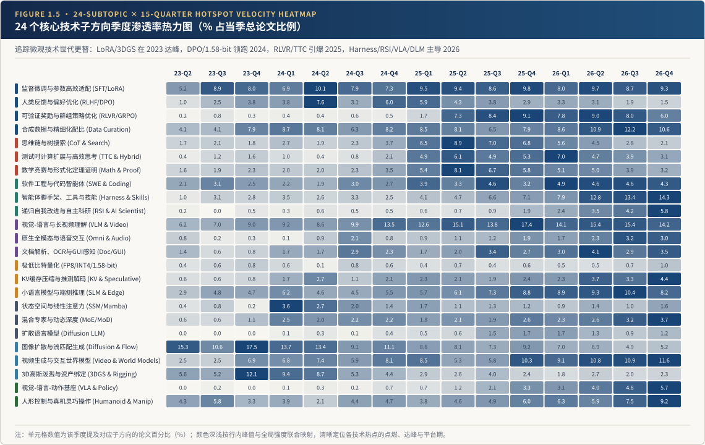

# 人工智能前沿研究编年史与技术演进导论（2023–2026）

> **欧美大学教材风活体编年史（Living University Textbook）** ｜ 累计覆盖 **18,137 篇**论文（`2023-05-04` — `2026-11-24`，共 920 个归档日）

📘 **全书精装合并版 PDF（含完整封面、目录、12 幅矢量桑基/趋势图与百篇里程碑全集）**：
👉 **[`AI_Research_Chronicle_Textbook.pdf`](./AI_Research_Chronicle_Textbook.pdf)**

---

## 核心全景可视化预览（桑基图与热力矩阵）







---

## 分章阅读导航（`chronicle/chapters/`）

| 章节标识 | 章节标题与独立 Markdown 入口 |
| :--- | :--- |
| `PREFACE` | [前言与导读：如何阅读这部“活体”人工智能编年史教材](./chapters/ch00_preface_and_guide.md) |
| `CHAPTER 01` | [第 1 章 宏观全景：2023–2026 人工智能研究规模定律与热点流向桑基图谱](./chapters/ch01_macro_landscape_sankey.md) |
| `CHAPTER 02` | [第 2 章 2023 年度编年史：开源破冰、架构挑战者与扩散生成黄金时代](./chapters/ch02_chronicle_2023.md) |
| `CHAPTER 03` | [第 3 章 2024 年度编年史：1.58 比特风暴、混合架构合流与早期全模态融合](./chapters/ch03_chronicle_2024.md) |
| `CHAPTER 04` | [第 4 章 2025 年度编年史：可验证强化学习（RLVR）与测试时推理超级周期](./chapters/ch04_chronicle_2025.md) |
| `CHAPTER 05` | [第 5 章 2026 年度编年史：智能体脚手架、世界模型、递归自我改进与物理主体元年](./chapters/ch05_chronicle_2026.md) |
| `CHAPTER 06` | [第 6 章 序列建模与模型架构演进：从 Transformer 垄断到混合状态空间、扩散语言模型与流形超连接](./chapters/ch06_architecture_evolution.md) |
| `CHAPTER 07` | [第 7 章 训练范式、强化学习与数据工程：从 SFT/DPO 到 RLVR、多奖励解耦与手术刀式数据精选](./chapters/ch07_training_rl_data.md) |
| `CHAPTER 08` | [第 8 章 推理机制与测试时计算扩展：从提示技巧、算力缩放到“思考幻觉”与混合思考](./chapters/ch08_reasoning_test_time.md) |
| `CHAPTER 09` | [第 9 章 模型效率、极低比特量化与推理系统工程：单位算力智能密度的极限压榨](./chapters/ch09_efficiency_systems.md) |
| `CHAPTER 10` | [第 10 章 多模态理解与原生统一基座：从外挂视觉适配器到全模态早融合与长视频空间推理](./chapters/ch10_multimodal_unified.md) |
| `CHAPTER 11` | [第 11 章 自主智能体、代码工程与递归自我改进：从工具调用到脚手架工程与 RSI 闭环](./chapters/ch11_agents_coding_rsi.md) |
| `CHAPTER 12` | [第 12 章 视觉生成、三维世界模型与具身物理代理：从像素合成美学走向牛顿定律与真机全身控制](./chapters/ch12_vision_world_embodied.md) |
| `CHAPTER 13` | [第 13 章 安全对齐、可信治理与机制可解释性：能力狂飙背后的剪刀差、扑克脸与对齐熵增](./chapters/ch13_safety_interpretability.md) |
| `CHAPTER 14` | [第 14 章 科学基础模型、持续长程记忆与全球开源生态格局](./chapters/ch14_science_memory_open.md) |
| `APPENDIX A` | [附录 A 定量分类学、质量守恒桑基流向模型与活体教材自动化构建规范](./chapters/appA_methodology_taxonomy.md) |
| `APPENDIX B` | [附录 B 2023–2026 百篇最高影响力里程碑论文结构化精粹（Top 100 Landmark Compendium）](./chapters/appB_landmark_compendium.md) |
| `APPENDIX C` | [附录 C 人工智能前沿双向术语一致性对照表（Bilingual Technical Glossary）](./chapters/appC_bilingual_glossary.md) |

---

## 矢量插图索引（`chronicle/figures/`）

1. [`fig01_volume_growth_and_engagement.svg`](./figures/fig01_volume_growth_and_engagement.svg) — 2023–2026 季度规模扩张、社区热度与代码开源率双轴图
2. [`fig02_master_sankey_2023_2026.svg`](./figures/fig02_master_sankey_2023_2026.svg) — 跨年度十大研究赛道注意力流向全景桑基图
3. [`fig03_paradigm_genealogy_sankey.svg`](./figures/fig03_paradigm_genealogy_sankey.svg) — 核心技术范式四代演进谱系桑基图
4. [`fig04_quarterly_stream_share.svg`](./figures/fig04_quarterly_stream_share.svg) — 15 季度研究份额 100% 堆叠面积流图
5. [`fig05_subtopic_velocity_heatmap.svg`](./figures/fig05_subtopic_velocity_heatmap.svg) — 24 核心子方向 × 15 季度渗透率热力图
6. [`fig06_2023_2024_transition_sankey.svg`](./figures/fig06_2023_2024_transition_sankey.svg) — 2023 → 2024 奠基向效率/早融合跃迁桑基图
7. [`fig07_2025_2026_transition_sankey.svg`](./figures/fig07_2025_2026_transition_sankey.svg) — 2025 → 2026 推理超级周期向智能体与具身跃迁桑基图
8. [`fig08_architecture_and_efficiency_trends.svg`](./figures/fig08_architecture_and_efficiency_trends.svg) — 序列架构与高效推理系统季度趋势图
9. [`fig09_training_and_reasoning_coevolution.svg`](./figures/fig09_training_and_reasoning_coevolution.svg) — 训练信号三代迁移与推理范式协同演进图
10. [`fig10_multimodal_agents_embodied_rise.svg`](./figures/fig10_multimodal_agents_embodied_rise.svg) — 智能体脚手架、世界模型与具身 VLA 爆发曲线
11. [`fig11_institutions_and_open_ecosystem.svg`](./figures/fig11_institutions_and_open_ecosystem.svg) — 全球头部机构产出格局与各领域开源代码比例图
12. [`fig12_safety_vs_capability_arms_race.svg`](./figures/fig12_safety_vs_capability_arms_race.svg) — 自主能力前沿与安全护栏剪刀差演进图

---

## 本地或 CI 一键重编译命令

```bash
# 安装轻量 PDF 排版引擎依赖
pip install -r requirements.txt

# 一键增量生成单篇总结 + 重绘全部桑基/趋势图 + 同步活体章节 + 编译合并教材 PDF
python scripts/update_all.py --skip-fetch
```
