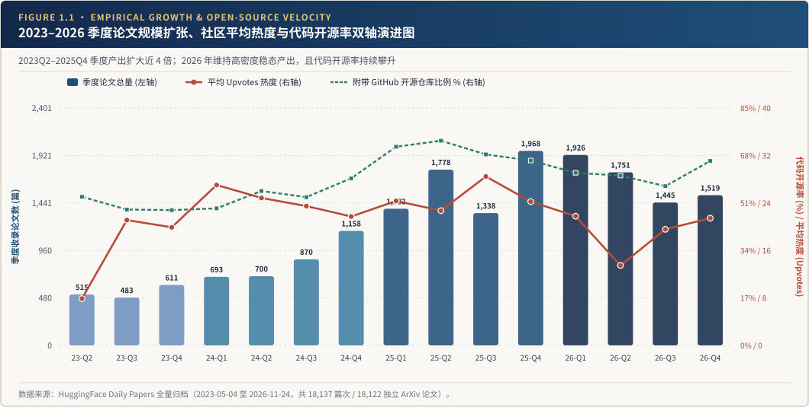
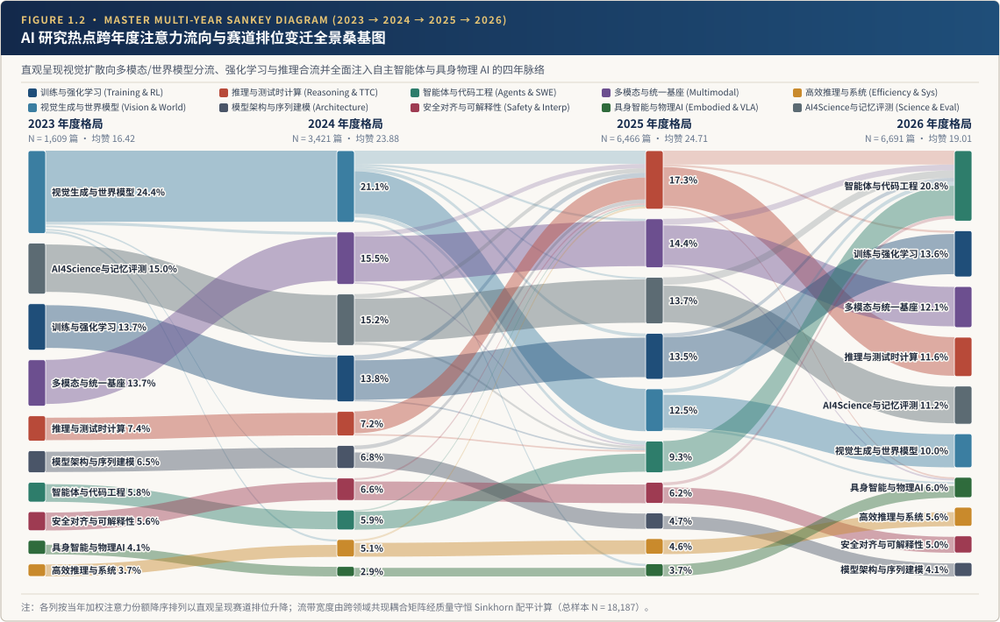
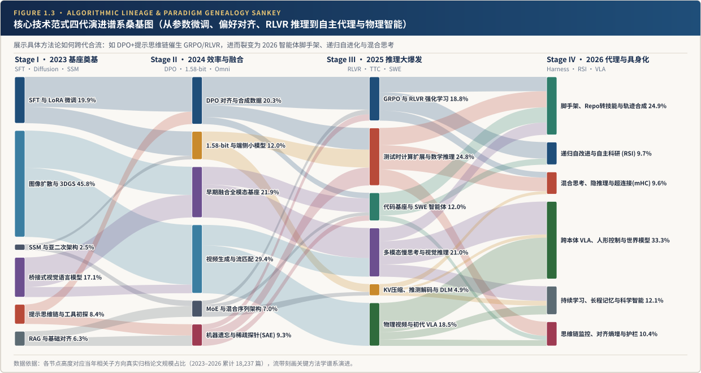
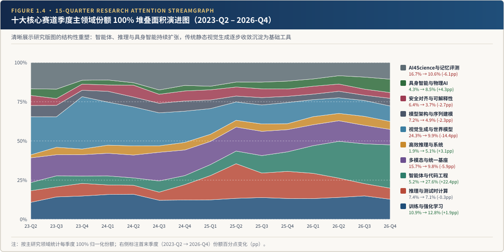
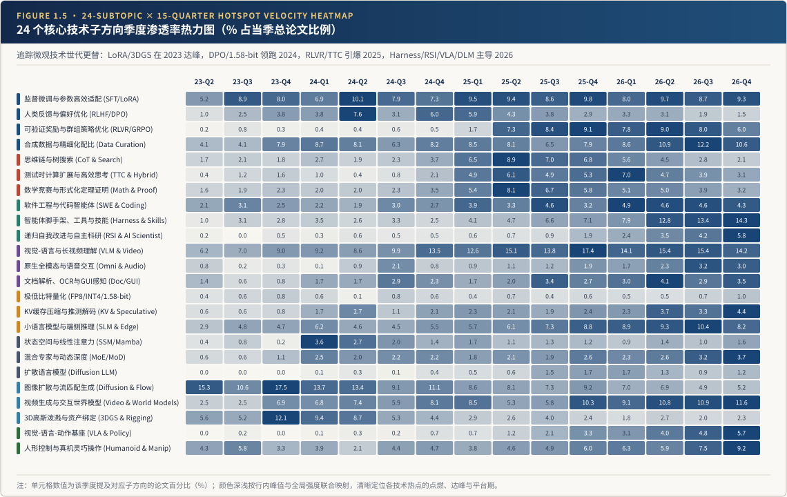

# 第 1 章 宏观全景：2023–2026 人工智能研究规模定律与热点流向桑基图谱

> **[LEARNING OBJECTIVES · 本章学习目标]**
> 1. 定量把握 2023–2026 年间人工智能前沿论文产出的指数扩张与高密度稳态规律、社区关注度（Upvotes）分布特征及开源代码伴随率变化。
> 2. 读懂**跨年度热点流向全景桑基图（Master Sankey Diagram）**与**核心技术范式四代谱系桑基图**，理解不同研究赛道之间注意力转移与方法论杂交的因果脉络。
> 3. 从 15 个季度的堆叠流图与 24 个微观子方向热力矩阵中，识别“奠基期 → 效率优化期 → 推理超级周期 → 自主代理与具身物理期”四阶段相变规律。

---

## 1.1 四年演进的宏观规模：从指数爆发到高密度前沿稳态

如果站在 2026 年末回望过去四年的机器学习学术史，最直观的冲击首先来自研究产出的绝对体量与组织化程度。基于本仓库收录的自 `2023-05-04` 起的连续日度归档，Hugging Face Daily Papers 见证了全球大模型与生成式人工智能研究从早期社区自发探索走向工业级系统化攻坚的完整轨迹。

<!-- AUTO-SYNC:START:macro_overview_table -->

### 表 1.1 2023–2026 年度宏观规模与核心领域主份额演进总表（实时同步自归档库）

| 年份 | 归档论文数 | 平均热度 (Upvotes) | 代码开源率 (GitHub) | 年度第一大主赛道 | 年度最高热度代表作 |
| :--- | ---: | ---: | ---: | :--- | :--- |
| **2023** | 1,609 篇 | 16.42 | 50.0% | 视觉生成与世界模型 (26.3%) | [LLM in a flash: Efficient Large Language M...](https://huggingface.co/papers/2312.11514) (`260` 赞) |
| **2024** | 3,421 篇 | 23.88 | 55.0% | 视觉生成与世界模型 (22.7%) | [The Era of 1-bit LLMs: All Large Language ...](https://huggingface.co/papers/2402.17764) (`627` 赞) |
| **2025** | 6,466 篇 | 24.71 | 69.7% | 推理与测试时计算 (17.9%) | [Sharing is Caring: Efficient LM Post-Train...](https://huggingface.co/papers/2509.08721) (`662` 赞) |
| **2026** | 6,741 篇 | 18.98 | 61.6% | 智能体与代码工程 (23.2%) | [A Very Big Video Reasoning Suite](https://huggingface.co/papers/2602.20159) (`514` 赞) |
| **全周期累计** | **18,237 篇** | **21.70** | **62.2%** | 跨代演进（共 922 天） | 去重唯一 ArXiv：18,222 篇 |

### 表 1.2 十大核心赛道跨年度主领域论文数与多标签渗透率对照矩阵

| 核心研究赛道 | 2023 主域 (多标签%) | 2024 主域 (多标签%) | 2025 主域 (多标签%) | 2026 主域 (多标签%) | 跨期演进态势 |
| :--- | ---: | ---: | ---: | ---: | :--- |
| **训练与强化学习** | 216 (21.6%) | 471 (21.8%) | 858 (25.5%) | 926 (25.0%) | 高位稳态 → (`+0.3pp`) |
| **推理与测试时计算** | 118 (11.6%) | 240 (12.0%) | 1,156 (29.8%) | 753 (22.5%) | 稳步扩容 ↑ (`+3.8pp`) |
| **智能体与代码工程** | 90 (9.4%) | 202 (9.1%) | 634 (15.8%) | 1,564 (32.0%) | 强劲跃升 ↑↑ (`+17.6pp`) |
| **多模态与统一基座** | 229 (19.2%) | 550 (22.8%) | 962 (25.1%) | 817 (22.4%) | 高位稳态 → (`-2.1pp`) |
| **高效推理与系统** | 55 (6.3%) | 169 (8.6%) | 278 (9.2%) | 347 (11.7%) | 稳步扩容 ↑ (`+1.7pp`) |
| **视觉生成与世界模型** | 423 (31.8%) | 778 (28.9%) | 861 (20.7%) | 689 (18.0%) | 沉淀分流 ↓ (`-16.1pp`) |
| **模型架构与序列建模** | 97 (11.2%) | 220 (11.7%) | 284 (9.6%) | 268 (8.1%) | 高位稳态 → (`-2.1pp`) |
| **安全对齐与可解释性** | 78 (10.8%) | 205 (12.1%) | 359 (13.2%) | 293 (11.2%) | 高位稳态 → (`-0.5pp`) |
| **具身智能与物理AI** | 66 (6.3%) | 98 (4.9%) | 244 (6.7%) | 434 (10.1%) | 稳步扩容 ↑ (`+2.3pp`) |
| **AI4Science与记忆评测** | 237 (23.7%) | 488 (26.5%) | 830 (27.6%) | 650 (25.4%) | 沉淀分流 ↓ (`-5.1pp`) |

<!-- AUTO-SYNC:END:macro_overview_table -->

观察图 1.1 所呈现的 15 个季度双轴演进曲线，我们可以提炼出三条极具解释力的宏观经验规律：

1. **三阶产能跃升与高密度平台期**：2023 年 Q2–Q4 季度均产仅约 536 篇；2024 年伴随开源基座（Llama 3、Qwen2/2.5、DeepSeek-V2）普及，季度产出攀升至 `2024-Q4` 的 1,158 篇；2025 年受强化学习推理浪潮催化，季度规模进一步跃上 1,300–1,968 篇台阶；进入 2026 年后，每季度稳定维持在 1,440–1,920 篇的高位区间。这表明社区筛选机制已从无序膨胀进入高门槛稳态竞争。
2. **社区审美的成熟化（“唯突破论”效应）**：平均单篇点赞数（Upvotes）从 2023 年的 16.4 跃升至 2024–2025 年的 23.9–24.7，而在论文基数继续扩大的 2026 年回落稳定在 ~19–23 区间，同时头部前 1% 论文（300–660+ 赞）的极值热度空前集中。换言之，增量式微改（Incremental Tweaks）已难以激起涟漪，唯有真正重构范式的算法、数据配方或全栈开源系统才能赢得全社区投票。
3. **开源代码成为一等公民**：附带 GitHub 代码仓库链接的论文比例从 2023 年的约 50.0% 一路攀升至 2025 年近 70%，2026 年依然维持在 60% 以上高位。可复现代码与权重已从“加分项”演变为高影响力研究的准入门槛。

---

## 1.2 像读水系图一样读学术史：跨年度研究热点全景桑基图

传统文献计量学往往只给出一张静态柱状图，告诉读者某一年某领域有多少篇论文，却无法回答更具洞察力的核心问题：**当一个旧热点的份额收缩时，原本投入其中的智力资本与算力流向了哪里？当一个新兴赛道突然爆发时，它是由哪些上游技术支流汇聚而成的？**

为了直观揭示这种动态演化，我们利用全库论文的**主领域归属（Primary Domain）**与**跨领域多标签共现耦合矩阵（Cross-Domain Co-occurrence Matrix）**，经质量守恒的 Sinkhorn 双随机配平算法，构建了图 1.2 所示的 **2023 → 2024 → 2025 → 2026 跨年度研究注意力全景桑基图（Master Multi-Year Sankey Diagram）**。图中每一列代表一个自然年度，节点按当年加权研究份额从高到低纵向排列，流带宽度精确正比于跨年度延续与跨赛道迁移的权重。

顺着图 1.2 的彩色流带从左向右追踪，四条波澜壮阔的“学术大江改道”跃然纸上：

- **第一条主航道：视觉生成的“开枝散叶”（蓝色流带下移与分流）**
  2023 年，**视觉生成与世界模型**（`Vision & World`）以高达 **24.4%** 的加权注意力稳居全领域第一大板块——彼时社区沉浸在 Stable Diffusion XL、ControlNet 与三维高斯泼溅（3D Gaussian Splatting，3DGS）的狂欢中。然而自 2024 至 2026 年，静态文生图逐渐工程成熟化，该板块相对份额一路收敛至 **10.0%**（退居第六）。它的注意力并未消失，而是沿着两条粗壮支流向外注入：一支汇入紫色**多模态理解与统一基座**，推动早期模态融合（Early Fusion）；另一支汇入绿色**具身智能与物理 AI**，将视频扩散器改造为遵循牛顿力学的交互式世界模型与机器人策略发生器。
- **第二条主航道：推理赛道在 2025 年的“惊天夺冠”与 2026 年的“基础设施化”（砖红色流带）**
  2023–2024 年间，**推理与测试时计算**（`Reasoning & TTC`）仅占约 **7.2%–7.4%**，屈居第五。2025 年，受 DeepSeek-R1、rStar-Math 与测试时算力缩放驱动，砖红色节点陡然膨胀至 **17.3%**，一举登顶 2025 年度全领域榜首！更为微妙的转折发生在 2025 → 2026：砖红色节点在 2026 年主动回落至 **11.6%**（位列第四），而从它右侧流出的宽阔色带大规模注入了青绿色**智能体与代码工程**。这揭示了一个深刻的科学史规律：**2025 年解决了“模型如何深度思考”，2026 年则立即把这种思考能力封装进长程自主行动系统之中——推理从独立研究目标变成了所有上层智能体的默认发动机。**
- **第三条主航道：自主智能体的“三级跳登顶”（青绿色流带逆袭）**
  在 2023 年仅占 **5.8%**（排名第七）的**智能体与代码工程**（`Agents & SWE`），在吸收了训练强化学习（深蓝）、长链推理（砖红）与多模态界面感知（紫色）三大上游支流后，于 2025 年升至 **9.3%**，并在 2026 年彻底爆发至 **20.7%**，以绝对优势加冕 2026 年最大研究热点！
- **第四条主航道：训练强化学习的“定海神针”与具身/效率的稳步抬升**
  深蓝色**训练与强化学习**四年间始终稳居 **13.5%–13.8%** 的核心枢纽位置，充当全领域的动力泵；与此同时，草绿色**具身智能与物理 AI**（4.1% → 6.0%）与琥珀色**高效推理与系统**（3.7% → 5.6%）双双实现超过 45% 的相对份额扩容。

---

## 1.3 方法论谱系微观透视：四代技术范式如何跨代杂交？

如果说图 1.2 展示了十大宏观赛道的版图重构，那么图 1.3 的**核心技术范式四代演进谱系桑基图**则进一步下潜到算法与架构颗粒度，刻画了四个历史阶段（Stage I–IV）内部 24 个代表性技术簇之间的传承与突变关系。

> **[PARADIGM SHIFT · 范式跃迁洞察]** **从“模型中心主义”向“脚手架-环境-自进化闭环”的迁移**
> 对比图 1.3 的 Stage I（2023）与 Stage IV（2026）可以发现：2023 年几乎所有高赞工作都在修改模型权重或单次前向结构（如 QLoRA 改适配器、Mamba 改序列算子、SDXL 改扩散主干）；而到了 2026 年，最活跃的前沿节点已演变为**智能体脚手架与代码库转技能（Repo-to-Skill / Harness，25.0%）**、**跨本体 VLA 与世界模型（33.1%）**以及**递归自我改进（RSI，9.7%）**。研究的基本单元已从“单个神经网络”升级为“基座模型 + 可编程脚手架 + 可验证合成环境 + 持续记忆库”的复合认知系统。

---

## 1.4 十五季度时间序列切片与微观子方向速度热力图

为了消除年度聚合可能掩盖的季度拐点，图 1.4 与图 1.5 进一步将时间分辨率细化至 `2023-Q2` 至 `2026-Q4` 共 15 个连续季度。

在图 1.4 的 100% 堆叠面积流图中，可以精确锁定三次历史性拐点的发生季度：

1. **`2024-Q1` 至 `2024-Q2`**：以 BitNet b1.58、GaLore、Phi-3 与 Chameleon 为标志，效率压缩与早期融合多模态首次挤压传统单模态扩散模型的份额；
2. **`2025-Q1` 至 `2025-Q2`**：DeepSeek-R1（2025 年 1 月）引发砖红色推理带出现陡峭的阶跃峰值，主领域占比单季突破 22%；
3. **`2026-Q1` 至 `2026-Q4`**：青绿色智能体色带呈现近乎单调递增的扩张斜率，至 `2026-Q4` 主领域份额高达 **27.4%**（较 `2023-Q2` 的 5.2% 净增 **+22.1 个百分点**），同时顶部深绿色具身智能带扩张至 **8.6%**（净增 **+4.3 个百分点**）。

图 1.5 的 **24×15 热力矩阵**则如同一张高分辨率基因表达谱，清晰记录了每一项具体技术的生命周期曲线：

- **早期达峰并沉淀为常规基建的技术**：`图像扩散与流匹配`（`23-Q4` 达 17.5% → `26-Q4` 降至 5.3%）、`3D 高斯泼溅与资产绑定`（`23-Q4` 达 12.1% → `26-Q4` 稳定在 2.4%）、`RLHF/DPO 偏好优化`（`24-Q2` 达 7.6% → `26-Q4` 降至 1.4%）。它们并非被淘汰，而是因为问题被较好解决、进入了开箱即用的工具箱阶段。
- **2025 年阶跃引爆并维持高位的核心引擎**：`可验证奖励与群组策略优化（RLVR/GRPO）`在 `24-Q4` 尚不足 0.5%，`25-Q2` 飙升至 7.3%，直至 `26-Q2` 仍高达 9.0%；`测试时计算扩展与混合思考`在 `26-Q1` 触及 7.0% 峰值后转向效率化精炼。
- **2026 年下半年仍在加速冲顶的新兴风暴眼**：
  - `智能体脚手架、工具与技能（Harness & Skills）`：从 `23-Q2` 的 1.0% 一路飙升至 `26-Q4` 的 **14.9%**；
  - `合成数据与精细化配比（Data Curation）`：在 `26-Q3` 创下 **12.2%** 的历史新高；
  - `视频生成与交互世界模型`：稳定攀升至 `26-Q4` 的 **11.3%**；
  - `人形控制与真机灵巧操作`（`26-Q4` 达 **9.1%**）与 `视觉-语言-动作基座（VLA）`（从 2023 年的 0.0% 跃升至 `26-Q4` 的 **5.8%**）；
  - `递归自我改进与自主科研（RSI）`：从长期低于 0.6% 的理论构想，在 `26-Q4` 突破至 **5.9%**！

---

## 1.5 本章小结（Chapter Summary）

- 2023–2026 年间，前沿 AI 研究走过了从每年翻倍扩张到季度 ~1,500+ 篇高密度创新的演进历程，开源代码率超过 60%，社区评价体系高度聚焦于根本性范式创新。
- 全景桑基流向图揭示了四年间最核心的宏观结构重组：**静态视觉生成退潮分流 → 强化学习与测试时推理在 2025 年合流爆发 → 推理能力在 2026 年全面下沉并引爆智能体脚手架、递归自进化与具身物理智能**。
- 微观热力矩阵表明，单点技术热点的半衰期约为 4–6 个季度；持续保持生命力的方向无一例外完成了从“单模型刷榜”向“闭环数据合成、可验证环境交互与系统工程协同”的跃迁。

---

## 1.6 思考与前沿研讨问题（Review & Research Questions）

1. **注意力守恒与迁移分析**：结合图 1.2 的桑基流带，解释为什么 `Reasoning & TTC` 的主领域占比在 2026 年相比 2025 年有所回落，但这并不意味着推理研究的重要性下降？
2. **技术成熟度曲线判别**：对比图 1.5 中 `RLHF/DPO`、`3DGS` 与 `RLVR/GRPO` 三行的季度演化序列，总结一项技术在 Daily Papers 中呈现“高增长 → 峰值 → 平稳回落”特征背后的两种截然不同的成因（“证伪淘汰” vs “基础设施化沉淀”）。
3. **前瞻预测**：观察 `26-Q2` 至 `26-Q4` 热力图中斜率最陡峭的四个子方向（`Harness & Skills`、`RSI`、`VLA`、`KV缓存与推测解码`），推导它们在未来四个季度可能发生怎样的交叉融合？
