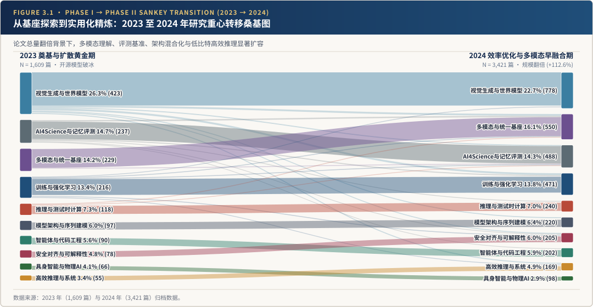

# 第 3 章 2024 年度编年史：1.58 比特风暴、混合架构合流与早期全模态融合

> **[LEARNING OBJECTIVES · 本章学习目标]**
> 1. 剖析 2024 年研究总规模翻倍（3,421 篇）背后的核心驱动力：从“盲目堆大参数”转向“极致每比特/每词元智能效率”。
> 2. 掌握 2024 年四大标志性技术突破：三值化 1.58-Bit 大模型（BitNet b1.58）、训练期梯度低秩投影（GaLore）、Mamba-Transformer-MoE 生产级混血架构（Jamba）以及原生早期模态融合（Chameleon / Emu3）。
> 3. 追踪 DeepSeekMath 中群组相对策略优化（GRPO）的诞生与多模态视觉盲点（VLMs Are Blind）的揭露，理解 2024 年如何完成了大推理时代前夜的关键技术蓄水。

---

## 3.1 时代背景：从“能不能做出来”到“能不能极致高效、原生统一”

进入 2024 年，大模型研究彻底告别了草莽试错期，全年归档论文数跃升至 **3,421 篇**（较 2023 年增长 **112.6%**），单篇平均社区点赞数更是飙升 **45.4%** 达到 **23.88**。这一年学界集体反思的核心问题是：千亿级全精度稠密自回归 Transformer 固然有效，但它在**矩阵乘法能耗、训练显存墙、冗余深层计算、外挂式多模态割裂以及强化学习价值网络开销**五个维度上都显得过于笨重。

如图 3.1 的 **2023 → 2024 跨阶段桑基转移图**所示，2024 年见证了多模态理解（升至 16.1% 主领域份额）、科学评测基准（14.3%）、训练对齐（13.8%）与效率系统（显著扩容）的全面繁荣。

<!-- AUTO-SYNC:START:year_2024_table -->

### 表 3.1 2024 年度归档核心统计与 Top 12 社区最高影响力论文榜

- **年度收录总量**：**3,421 篇**（季度分布：`2024-Q1`: 693 篇 · `2024-Q2`: 700 篇 · `2024-Q3`: 870 篇 · `2024-Q4`: 1,158 篇）
- **平均社区热度**：**23.88 Upvotes** ｜ **代码仓库开源率**：**55.0%**

| 排名 | 日期 | ArXiv ID | 论文标题 | 机构 | 主领域 | Upvotes |
| ---: | :--- | :--- | :--- | :--- | :--- | ---: |
| 1 | `2024-02-28` | [2402.17764](https://arxiv.org/abs/2402.17764) | [The Era of 1-bit LLMs: All Large Language Models are in ...](https://huggingface.co/papers/2402.17764) | — | 高效推理与系统 | **627** |
| 2 | `2024-12-20` | [2412.15115](https://arxiv.org/abs/2412.15115) | [Qwen2.5 Technical Report](https://huggingface.co/papers/2412.15115) | — | 训练与强化学习 | **377** |
| 3 | `2024-04-23` | [2404.14219](https://arxiv.org/abs/2404.14219) | [Phi-3 Technical Report: A Highly Capable Language Model ...](https://huggingface.co/papers/2404.14219) | Microsoft | 训练与强化学习 | **259** |
| 4 | `2024-10-30` | [2410.18057](https://arxiv.org/abs/2410.18057) | [CLEAR: Character Unlearning in Textual and Visual Modali...](https://huggingface.co/papers/2410.18057) | — | 安全对齐与可解释性 | **209** |
| 5 | `2024-02-28` | [2402.17485](https://arxiv.org/abs/2402.17485) | [EMO: Emote Portrait Alive - Generating Expressive Portra...](https://huggingface.co/papers/2402.17485) | — | 视觉生成与世界模型 | **194** |
| 6 | `2024-01-02` | [2401.00908](https://arxiv.org/abs/2401.00908) | [DocLLM: A layout-aware generative language model for mul...](https://huggingface.co/papers/2401.00908) | — | 多模态与统一基座 | **189** |
| 7 | `2024-03-07` | [2403.03507](https://arxiv.org/abs/2403.03507) | [GaLore: Memory-Efficient LLM Training by Gradient Low-Ra...](https://huggingface.co/papers/2403.03507) | — | 训练与强化学习 | **189** |
| 8 | `2024-03-21` | [2403.13372](https://arxiv.org/abs/2403.13372) | [LlamaFactory: Unified Efficient Fine-Tuning of 100+ Lang...](https://huggingface.co/papers/2403.13372) | — | 训练与强化学习 | **182** |
| 9 | `2024-10-08` | [2410.05258](https://arxiv.org/abs/2410.05258) | [Differential Transformer](https://huggingface.co/papers/2410.05258) | — | 模型架构与序列建模 | **181** |
| 10 | `2024-08-09` | [2408.04619](https://arxiv.org/abs/2408.04619) | [Transformer Explainer: Interactive Learning of Text-Gene...](https://huggingface.co/papers/2408.04619) | — | 模型架构与序列建模 | **175** |
| 11 | `2024-07-16` | [2407.10671](https://arxiv.org/abs/2407.10671) | [Qwen2 Technical Report](https://huggingface.co/papers/2407.10671) | — | AI4Science与记忆评测 | **168** |
| 12 | `2024-12-19` | [2412.13663](https://arxiv.org/abs/2412.13663) | [Smarter, Better, Faster, Longer: A Modern Bidirectional ...](https://huggingface.co/papers/2412.13663) | — | 训练与强化学习 | **161** |

<!-- AUTO-SYNC:END:year_2024_table -->

---

## 3.2 季度演进脉络：2024 年四季度全景叙事

### 2024 Q1（1–3 月）：1.58 比特核爆、GaLore 显存革命与 GRPO 悄然埋伏

2024 年开年第一季度便诞生了多篇改写教科书的重量级成果：

- **三值化权重的哲学冲击**：2 月底发表的 **BitNet b1.58**（*The Era of 1-bit LLMs: All Large Language Models are in 1.58 Bits*，`2402.17764`）以惊人的 **627 赞**刷新全年最高纪录。作者将权重约束在三值集合 $\{-1, 0, +1\}$（信息熵约 $\log_2 3 \approx 1.58$ bits），将昂贵的浮点矩阵乘法（MatMul）彻底退化为纯整数加减法，在 3B 规模起即可在同等词元预算下追平 FP16 LLaMA 的困惑度与下游任务表现，同时大幅削减延迟、显存与芯片能耗。
- **全参数训练突破单卡壁垒**：3 月 **GaLore**（`2403.03507`，189 赞）证明权重梯度在训练动态中天然具备低秩结构，通过对梯度矩阵而非权重本身做低秩投影（区别于 LoRA 限制参数子空间），削减优化器状态显存达 **65.5%**，首次在单张 24GB RTX 4090 消费级显卡上实现从头预训练 7B 全参数模型。同月开源的 **LlamaFactory**（`2403.13372`，182 赞）统一封装百余种基座与高效微调算法，成为社区事实上的标准训练工作台。
- **埋下 2025 推理革命火种的一篇数学论文**：2 月 **DeepSeekMath** 提出 **群组相对策略优化（Group Relative Policy Optimization，GRPO）**——果断砍掉传统近端策略优化（PPO）中与策略网络同等大小、极占显存的价值评估网络（Critic），改为对同一问题采样一组输出并以组内归一化奖励估计基线优势。当时鲜有人预料到，这一简洁算法将在十一个月后托举起震惊世界的 DeepSeek-R1。
- **深层冗余的解剖刀**：*The Unreasonable Ineffectiveness of the Deeper Layers*（3 月）实证发现直接剪除大模型后半段高达近一半的深层网络，经轻量微调后性能几乎不降，直接刺破了“每一层都在做深度非线性推理”的迷思。

> **[LANDMARK STUDY · 里程碑论文精读]** **The Era of 1-bit LLMs / BitNet b1.58 (ArXiv: 2402.17764 · 2024-02 · 627 Upvotes)**
> - **核心观点**：大语言模型的全部表征潜能无需 16 比特浮点数承载，引入显式零值的三值权重 $\{-1, 0, +1\}$ 既保留了特征过滤稀疏性，又消除了浮点乘法器瓶颈。
> - **方法与实验**：采用绝对均值（absmean）量化函数从头开展量化感知训练（QAT），在 RedPajama 数据集上系统对比 700M、1.3B、3B、3.9B 等多尺寸 BitNet b1.58 与同配置 FP16 LLaMA LLM。
> - **实验结论**：从 3B 规模开始，BitNet b1.58 在 ARC、HellaSwag、WinoGrande、GSM8K 等基准上全面匹敌甚至微超 FP16 基线，推理延迟降低 **2.71×**、显存占用下降 **3.55×**、矩阵算术能耗锐减 **71.4×**。
> - **核心启示**：重新定义了算法-硬件协同设计（Co-design）的想象空间，引发了后续专用低比特推理算子与边缘端芯片架构热潮。

### 2024 Q2（4–6 月）：手机端 Phi-3、混血架构 Jamba 与早期模态融合破壁

第二季度，研究焦点全面转向“架构混血”、“词元级精选”与“多模态拆墙”：

- **端侧智能里程碑与选择性词元训练**：微软发布 **Phi-3 Technical Report**（`2404.14219`，259 赞），仅 3.8B 参数经 4-bit 量化后可在 iPhone 本地流畅离线运行（>12 tokens/s），基准成绩比肩 Mixtral 8x7B 与 GPT-3.5；同期 **Rho-1** 提出选择性语言建模（Selective Language Modeling），指出预训练语料中并非所有词元都值得同等学习，仅对高超额损失的关键词元反向传播即可提速 5–10 倍达到同等数学推理水平。
- **架构战争走向融合**：AI21 Labs 推出 **Jamba**（4 月），首次将 Transformer 注意力层、Mamba 状态空间层与混合专家（MoE）融合于同一生产级大模型，单张 80GB GPU 即可容纳 256K 上下文键值缓存；Google DeepMind 提出 **Mixture-of-Depths（混合深度路由）**，为每个词元动态决定穿过还是跳过当前层。
- **多模态“拆掉适配器之墙”与无中生有对齐数据**：5 月 Meta 发表 **Chameleon**，抛弃外挂 CLIP 视觉编码器，将图像与文本统一量化为离散词元流送入单一自回归 Transformer，实现真正的**早期模态融合（Early Fusion）**；6 月 **Magpie** 发现仅向对齐模型输入空白前置模板，模型便会自动“自言自语”吐出极高质量的用户指令与回复对，开创零种子合成指令数据新范式；Hugging Face 同期开源 **15 万亿词元的 FineWeb**，彻底拉平了学界与大厂的开源预训练语料底座。

### 2024 Q3（7–9 月）：视觉盲区冷水、神经游戏引擎与 AI 科学家初啼

第三季度呈现“能力突破与清醒祛魅并存”的张力：

- **祛魅时刻——VLMs Are Blind**：7 月论文 *Vision Language Models Are Blind* 给高歌猛进的多模态榜单泼下一盆清醒冷水：在数重叠圆圈、判断两条线是否相交、识别圈出字母等学龄前儿童近 100% 正确的几何感知题上，GPT-4o 与 Claude 3.5 Sonnet 准确率仅约 50%–60%，暴露出离散视觉块编码对精细空间拓扑的严重丢失。
- **生成即模拟、全模态单目标统一**：8 月 **GameNGen** 让扩散模型以 20 FPS 实时交互渲染经典游戏《DOOM》每一帧画面与状态响应，首次展示“神经网络即游戏引擎（世界模型雏形）”；9 月智源推出 **Emu3**，证明无需扩散模型或 CLIP，仅凭纯粹的“预测下一个词元（Next-Token Prediction）”即可在图文视频生成与理解上追平旗舰专用模型；AI2 发布全栈真开源多模态模型 **Molmo/PixMo**（权重+数据+配方全公开）。
- **自动化科研流水线初探**：Sakana AI 发表 *The AI Scientist*（8 月），首次演示从文献构思、编写实验代码、绘图到撰写 LaTeX 论文并模拟同行评审的端到端智能体闭环（单篇算力成本约 15 美元）。

### 2024 Q4（10–12 月）：差分注意力、多模态机器遗忘与开源旗舰收官战

年末第四季度单季论文首次突破千篇（**1,158 篇**）：

- **降噪注意力与现代编码器复兴**：微软提出 **Differential Transformer（差分 Transformer）**（`2410.05258`，181 赞），仿照降噪耳机用两组 Softmax 注意力相减抵消上下文注意力噪声，显著缓解长上下文“迷失中间（Lost-in-the-Middle）”与幻觉问题；12 月 **ModernBERT**（`2412.13663`，161 赞）将旋转位置编码（RoPE）、FlashAttention 与交替局部/全局注意力引入双向编码器，让沉寂多年的 BERT 家族重焕生机。
- **多模态安全遗忘与慢思考前奏**：**CLEAR**（`2410.18057`，209 赞）建立首个图文跨模态角色知识机器遗忘基准；11 月 **LLaVA-o1** 率先探索结构化多阶段视觉慢思考；12 月底 **Qwen2.5 Technical Report**（`2412.15115`，377 赞，全年热度第二）以 18 万亿词元预训练与全尺寸开源矩阵完美收官，将开源基座能力推至爆发临界点。

---

## 3.3 本章小结（Chapter Summary）

- 2024 年是“精致工程与范式合流之年”：BitNet b1.58、GaLore、Phi-3 与 Rho-1 共同证明，算力效率、显存效率与词元信息密度可以替代粗放的参数膨胀。
- 序列架构从“替代 Transformer”转向“Transformer + SSM + MoE 协同混血”；多模态从“外挂编码器拼接”迈向“原生统一词元早期融合”。
- GRPO 算法的提出、18T 级高质开源基座（Qwen2.5 / Llama 3）的成熟以及合成数据管线的跑通，共同凑齐了 2025 年初推理大爆炸所需的全部燃料。

---

## 3.4 思考与前沿研讨问题（Review & Research Questions）

1. **低秩训练对比**：详细比较 LoRA 与 GaLore 在参数更新子空间、前向推理可合并性及训练显存节省来源上的本质异同。
2. **早期融合 vs 桥接适配**：Chameleon 与 Emu3 代表的离散词元早期模态融合在统一理解与生成上有何结构性优势？为何在精细 OCR 与高分辨率空间感知（参考 *VLMs Are Blind*）上仍面临词元量化损失挑战？
3. **算法伏笔分析**：为什么传统 PPO 在百亿级语言模型长序列生成训练中极易遭遇显存瓶颈与价值估计方差问题，而 GRPO 的组内相对归一化设计恰好契合数学与代码等可验证任务？
