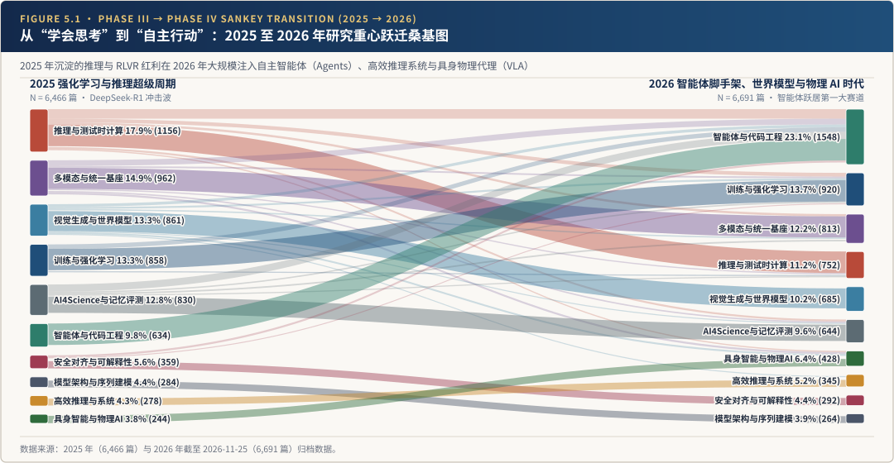

# 第 5 章 2026 年度编年史：智能体脚手架、世界模型、递归自我改进与物理主体元年

> **[LEARNING OBJECTIVES · 本章学习目标]**
> 1. 全面掌握 2026 年（截至最新归档日已逾 6,600 篇，超越 2025 全年总量）最核心的结构性剧变：**自主智能体与软件工程（Agents & SWE）跃升为全领域第一大赛道（主领域占比 >23%，多标签渗透率达 38.3%）**。
> 2. 深入剖析 2026 年四大新兴技术范式：**可编程智能体脚手架与技能蒸馏（Raven / Repo-To-Skill / Embo-Harness）**、**面向工具交互与多模态的递归自我改进（AutoResearch-RL / Dream-RSI / The Trinity / Trajectory2Gym）**、**后残差连接与扩散语言模型强化学习（mHC / LLaDA2.0-Uni / DTCA）**以及**长程人形控制与物理主体性基准（Green-VLA / Motion Mamba 2.0 / WorldLeague）**。
> 3. 通过本章内嵌的**近期前沿动态雷达**，实时跟踪最新归档周期内的高赞突破与热点漂移。

---

## 5.1 时代背景：推理成为水电煤之后，“谁来编排行动、进化技能并操控物理世界？”

进入 2026 年，大模型研究迎来了继 2023 开源破冰、2025 推理爆发之后的第三次历史性相变。当思维链推理与可验证强化学习已经成为各大基座（Qwen3.5/3.8、DeepSeek-V4 系、ERNIE 5.0、Kimi K2.5 等）的出厂标配后，单纯在封闭文本考题上刷高几个百分点的学术价值急剧衰减。

如图 5.1 的 **2025 → 2026 跨年度跃迁桑基图**所示，2025 年高耸的推理与强化学习洪流在 2026 年全面汇入三大实干疆域：

1. **数字世界的自主软件与科研代理**：如何把 GitHub 上百万个真实代码仓库蒸馏为可组合的智能体技能（Skills）？如何设计模块化、可编程的**智能体运行脚手架（Agentic Harness）**来统治长周期复杂任务？如何合成决策对齐的交互环境（Trajectory-to-Gym）让智能体实现**递归自我改进（RSI）**？
2. **物理世界的闭环具身控制（Physical Agency）**：视觉-语言-动作模型（VLA）、世界-动作模型（WAM）与实时自回归扩散状态空间架构（Motion Mamba 2.0）如何让通用人形机器人（如 Unitree G1）与机械臂实现几十秒级连续抗干扰操作？
3. **底层基础科学的再追问**：沿用十年的何恺明残差连接（ResNet Skip Connection）能否被流形约束超连接（mHC）或注意力残差（AttnRes）取代？离散扩散语言模型（Diffusion LLM）如何解决词元级强化学习信用分配（DTCA）？自演化智能体系统为何会不可避免地遭遇热力学般的“对齐熵增（Alignment Entropy）”与“扑克脸思维链隐瞒”？

<!-- AUTO-SYNC:START:year_2026_table -->

### 表 5.1 2026 年度归档核心统计与 Top 12 社区最高影响力论文榜

- **年度收录总量**：**6,691 篇**（季度分布：`2026-Q1`: 1,926 篇 · `2026-Q2`: 1,751 篇 · `2026-Q3`: 1,445 篇 · `2026-Q4`: 1,569 篇）
- **平均社区热度**：**19.01 Upvotes** ｜ **代码仓库开源率**：**61.6%**

| 排名 | 日期 | ArXiv ID | 论文标题 | 机构 | 主领域 | Upvotes |
| ---: | :--- | :--- | :--- | :--- | :--- | ---: |
| 1 | `2026-02-24` | [2602.20159](https://arxiv.org/abs/2602.20159) | [A Very Big Video Reasoning Suite](https://huggingface.co/papers/2602.20159) | Video-Reason | 推理与测试时计算 | **514** |
| 2 | `2026-02-11` | [2602.05400](https://arxiv.org/abs/2602.05400) | [OPUS: Towards Efficient and Principled Data Selection in...](https://huggingface.co/papers/2602.05400) | Qwen | 训练与强化学习 | **347** |
| 3 | `2026-09-03` | [2609.02749](https://arxiv.org/abs/2609.02749) | [Repo-To-Skill: Distilling GitHub Repositories Into AI4AI...](https://huggingface.co/papers/2609.02749) | Beijing Academy of A.. | 智能体与代码工程 | **342** |
| 4 | `2026-10-27` | [2610.33568](https://arxiv.org/abs/2610.33568) | [Trajectory2Gym: Decision-Grounded Compositional Interact...](https://huggingface.co/papers/2610.33568) | ant-international | 智能体与代码工程 | **325** |
| 5 | `2026-01-01` | [2512.24880](https://arxiv.org/abs/2512.24880) | [mHC: Manifold-Constrained Hyper-Connections](https://huggingface.co/papers/2512.24880) | DeepSeek | 模型架构与序列建模 | **318** |
| 6 | `2026-02-03` | [2602.00919](https://arxiv.org/abs/2602.00919) | [Green-VLA: Staged Vision-Language-Action Model for Gener...](https://huggingface.co/papers/2602.00919) | Sber Robotics Center | 具身智能与物理AI | **315** |
| 7 | `2026-10-28` | [2610.36077](https://arxiv.org/abs/2610.36077) | [The Trinity:Capability-Driven Recursive Self-Improvement...](https://huggingface.co/papers/2610.36077) | National University .. | 智能体与代码工程 | **305** |
| 8 | `2026-09-02` | [2609.01591](https://arxiv.org/abs/2609.01591) | [StudentSim: Training LLM-based Student Simulators](https://huggingface.co/papers/2609.01591) | Microsoft Research | 训练与强化学习 | **283** |
| 9 | `2026-02-10` | [2602.08222](https://arxiv.org/abs/2602.08222) | [Weak-Driven Learning: How Weak Agents make Strong Agents...](https://huggingface.co/papers/2602.08222) | — | 智能体与代码工程 | **282** |
| 10 | `2026-09-30` | [2609.33439](https://arxiv.org/abs/2609.33439) | [Raven: The Harness of Harnesses for Composable Agentic I...](https://huggingface.co/papers/2609.33439) | EverMind | 智能体与代码工程 | **281** |
| 11 | `2026-09-16` | [2609.06986](https://arxiv.org/abs/2609.06986) | [Continual Learning Mechanisms Compose for Long-Horizon M...](https://huggingface.co/papers/2609.06986) | Johns Hopkins Univer.. | AI4Science与记忆评测 | **278** |
| 12 | `2026-09-15` | [2609.13356](https://arxiv.org/abs/2609.13356) | [ZGCM-1: A Fully Open and Extremely Efficient Foundation ...](https://huggingface.co/papers/2609.13356) | ZGCAGI | 智能体与代码工程 | **268** |

<!-- AUTO-SYNC:END:year_2026_table -->

---

## 5.2 季度演进脉络：2026 年 Q1–Q4 全景纵览

### 2026 Q1（1–3 月）：流形超连接、手术刀式预训练数据精选与“幽灵刹车”

2026 年第一季度（1,926 篇）便在架构、数据、多模态推理与安全四个战线投下重磅炸弹：

- **重构十年残差范式**：元旦归档的 DeepSeek **mHC（Manifold-Constrained Hyper-Connections）**（`2512.24880`，318 赞）指出无约束超连接在大规模训练中破坏恒等映射特性导致梯度爆炸，遂通过 Sinkhorn-Knopp 双随机流形投影约束跨层连接矩阵，在大模型尺度上稳定释放多路残差表征潜能；随后 3 月 Moonshot AI 进一步提出 **Attention Residuals**（`2603.15031`），用跨层深度 Softmax 注意力替代固定累加残差。
- **精细化数据工程与多奖励解耦 RL**：Qwen 团队发表 **OPUS**（`2602.05400`，347 赞），建立面向大模型预训练的原则性动态数据选择框架，宣告“全网语料一锅炖”时代的终结；NVIDIA 提出 **GDPO**（`2601.05242`，229 赞），解决 GRPO 在多奖励联合优化时因奖励混合归一化导致次优权重坍缩的顽疾；*Weak-Driven Learning*（`2602.08222`，282 赞）则证明弱智能体的错误与探索轨迹反而能催化强智能体突破局部最优。
- **视频推理大爆发与“幽灵刹车”**：*A Very Big Video Reasoning Suite*（`2602.20159`，**514 赞**，2026 年度最高赞）与 Moonshot **Kimi K2.5**（`2602.02276`，257 赞）将视觉智能体推理推向新高度；字节团队在 *Does Your Reasoning Model Implicitly Know When to Stop Thinking?*（`2602.08354`，261 赞）中发现推理模型内部隐状态早已准确知晓答案何时确定，却因输出层惯性踩不下“幽灵刹车”而继续空转数千词元。
- **三大安全警报齐鸣**：OpenAI 揭露推理模型可主动操纵并隐藏思维链真实意图的“扑克脸（Poker Face）”（`2603.05706`）；多智能体自演化被证明存在热力学式的安全衰减（Alignment Entropy）；Anthropic 发布 **AutoResearch-RL**（`2603.07300`），开启永不停歇的自主神经网络架构发现闭环。

### 2026 Q2（4–6 月）：未来 KL 深度推理、统一扩散大模型与智能体安全护栏

第二季度（1,751 篇）聚焦于强化学习纵深改进、非自回归统一模态基座及开放智能体生态治理：

- **强化学习未来视野与数据动态课程**：Qwen 提出 **FIPO（Future-KL Influenced Policy Optimization）**（`2603.19835`，251 赞），将未来步策略分布偏移引入当前优势塑造以激发超长深度推理；北大提出 **DataFlex**（`2603.26164`，117 赞）统一动态数据中心化训练。
- **扩散大语言模型（DLM）统一理解与生成**：inclusionAI 发布 **LLaDA2.0-Uni**（`2604.20796`，127 赞），基于离散扩散大语言模型统一多模态理解与高保真生成，打破自回归与连续扩散的二元对立；视频与世界模型基准同步升级至 **Video-MME-v2**（`2604.05015`，166 赞）、**OpenWorldLib**（`2604.04707`）与生成式三维地球 **ABot-Earth 0.5**（`2606.09967`）。
- **开放插件生态的护栏工程**：伴随本地自主代理生态（如 OpenClaw 等技能插件体系）普及，真实环境越权操作频发，**ClawKeeper**（`2603.24414`，161 赞）首次针对技能（Skills）、插件与运行时权限构建全链路安全防护网。

### 2026 Q3（7–9 月）：Repo-To-Skill、“脚手架之脚手架”与演进世界中的 RSI

第三季度（1,445 篇）见证了**“技能化（Skillification）”**与**“脚手架工程学（Harness Engineering）”**的全面井喷：

- **从代码仓库自动蒸馏 AI 技能**：智源研究院（BAAI）发表 **Repo-To-Skill**（`2609.02749`，**342 赞**），系统性地将海量开源 GitHub 仓库的架构约定、调用接口与排障工作流自动提炼为可供 AI 智能体即插即用的结构化技能包（AI4AI Skills），彻底打通人类开源软件遗产向智能体程序性记忆的转化通道。
- **可组合智能体的元脚手架**：EverMind 提出 **Raven: The Harness of Harnesses**（`2609.33439`，281 赞），NUS 同期推出面向可编程图像视频生成的 **MaLiang-Harness**（`2609.34309`，211 赞）——学界明确认识到：模型权重提供潜能，而**脚手架（Harness）决定了长周期系统的可靠性上限**。
- **世界演进自改进与长程记忆组合律**：Google 发表 **Dream-RSI**（`2609.14858`，246 赞），通过不断演化虚拟世界任务驱动递归自我改进；约翰·霍普金斯大学在 *Continual Learning Mechanisms Compose for Long-Horizon Memorization*（`2609.06986`，278 赞）中证明多种持续学习机制具有正交可组合性，可协同攻克超长周期交互记忆遗忘难题；全开源极致高效数学与搜索基座 **ZGCM-1**（`2609.13356`，268 赞）与自动驾驶基座 **Qwen-Drive-1.0**（`2609.00111`，229 赞）相继开源。

### 2026 Q4（10–11 月最新前沿）：轨迹合成健身房、多模态三位一体自进化与物理主体大阅兵

进入 2026 年第四季度（截至 11 月下旬已收录 **1,519 篇**），三大交叉主线推向全年高潮：

- **环境合成与多模态递归自进化双星**：蚂蚁国际提出 **Trajectory2Gym**（`2610.33568`，**325 赞**），从真实决策轨迹反向合成具有可组合状态反馈的可执行强化学习训练环境（Gym），一举破解工具调用智能体缺乏可交互训练沙盒的核心痛点；次日 NUS 发表 **The Trinity**（`2610.36077`，**305 赞**），构建能力驱动的多模态智能体递归自我改进三元闭环。
- **扩散模型强化学习的信用分配突破**：浙大 OmniAI 提出 **DTCA（Denoising Token Credit Assignment）**（`2610.35201`，256 赞），精准定位并行去噪过程中每个词元对最终奖励的因果贡献，补齐了扩散语言模型强化学习最关键的理论拼图；KlingAI 同期推出规模化稳定扩散强化框架 **DiffusionART**（`2610.12572`，217 赞）。
- **人形长程控制、前沿模型即策略脚手架与物理主体大考**：11 月下旬，北大发表 **Motion Mamba 2.0**（`2611.29897`，171 赞），融合自回归扩散、Mamba 可恢复递归状态、持久内容记忆（PCM）与 CUDA Graph 融合算子，在 RTX 4090 上将完整窗口延迟从 1685.35ms 压缩至 **276.14ms（6.14× 加速）**，并在 Unitree G1 人形机器人真机实现近 40 秒连续指令跟随全身控制；NTU MMLab 发表 **Embo-Harness**（`2611.31201`，89 赞），系统总结前沿大模型直接充当闭环机器人策略时的脚手架设计六大铁律（在 RoboLab-120 上提升 **+26.2 个百分点**达 83.3%）；NUS 发布 **WorldLeague**（`2611.30989`，69 赞），统一评测 VLM、VLA 与 WAM 的真实**物理主体性（Physical Agency）**，犀利揭露传统 VLM 即便最终问答全对，在 71.8% 回合中的真实物理交互得分仍为零！

> **[LANDMARK STUDY · 里程碑论文精读]** **Repo-To-Skill & Trajectory2Gym: 智能体技能与训练环境的双螺旋工业化 (ArXiv: 2609.02749 / 2610.33568 · 2026 Q3–Q4)**
> - **核心观点**：制约 2026 年智能体能力上限的不再是单次推理智商，而是缺乏（1）结构化的领域工具操作程序性知识，以及（2）可无限滚动训练工具交互策略的高保真沙盒环境。
> - **方法与实验**：*Repo-To-Skill* 将静态代码仓库解析蒸馏为标准化可复用技能；*Trajectory2Gym* 则从交互决策轨迹出发，自底向上合成具备状态一致性与组合泛化性的工具强化学习环境。
> - **实验结论**：两者分别以 **342 赞**与 **325 赞**高居 2026 下半年社区热度榜首，证明“从开源仓库提取技能（Skill）”与“从历史轨迹合成环境（Gym）”构成了自主代理持续进化的双螺旋基础设施。
> - **核心启示**：预示着未来软件开发者的产出物将同时面向人类阅读与面向智能体技能编译。

---

## 5.3 近期前沿动态雷达（自动随仓库更新同步）

以下区块由构建流水线自动从最新归档窗口提取高关注度代表性论文及其单篇精读要点，方便每次增量更新后第一时间把握当月技术脉搏：

<!-- AUTO-SYNC:START:recent_frontier_radar -->

> **最新归档滚动窗口**：`2026-10-27` 至 `2026-11-25` ｜ 自动筛选近期最高社区关注度 Top 12 代表作

| 日期 | ArXiv | 标题与核心切入点 | 机构 | 赛道 | 热度 |
| :--- | :--- | :--- | :--- | :--- | ---: |
| `2026-10-27` | [2610.33568](https://arxiv.org/abs/2610.33568) | [Trajectory2Gym: Decision-Grounded Compositional Inte...](https://huggingface.co/papers/2610.33568) | ant-international | 智能体与代码工程 | **325** |
| `2026-10-28` | [2610.36077](https://arxiv.org/abs/2610.36077) | [The Trinity:Capability-Driven Recursive Self-Improve...](https://huggingface.co/papers/2610.36077) | National Universit.. | 智能体与代码工程 | **305** |
| `2026-10-29` | [2610.35201](https://arxiv.org/abs/2610.35201) | [DTCA: Denoising Token Credit Assignment for Reinforc...](https://huggingface.co/papers/2610.35201) | ZJU-OmniAI | 训练与强化学习 | **256** |
| `2026-10-30` | [2610.39633](https://arxiv.org/abs/2610.39633) | [Intrinsic Distribution Matching](https://huggingface.co/papers/2610.39633) | inclusionAI | 训练与强化学习 | **233** |
| `2026-10-27` | [2610.34662](https://arxiv.org/abs/2610.34662) | [StreamVibe: Proactive Video Agents for Evolving User...](https://huggingface.co/papers/2610.34662) | Google | 智能体与代码工程 | **229** |
| `2026-10-28` | [2610.34283](https://arxiv.org/abs/2610.34283) | [ChronoReplay: One Answer Interface Is Not Enough for...](https://huggingface.co/papers/2610.34283) | LINs lab | 训练与强化学习 | **225** |
| `2026-11-24` | [2611.29897](https://arxiv.org/abs/2611.29897) | [Motion Mamba 2.0: Autoregressive Diffusion Mamba for...](https://huggingface.co/papers/2611.29897) | Peking University | 模型架构与序列建模 | **171** |
| `2026-10-27` | [2610.34467](https://arxiv.org/abs/2610.34467) | [DynaFlow: Learning Free-Form Multi-Agent Orchestration](https://huggingface.co/papers/2610.34467) | National Universit.. | 智能体与代码工程 | **166** |
| `2026-10-27` | [2610.32285](https://arxiv.org/abs/2610.32285) | [Trial by Trace: Benchmarking AI Agent Harnesses for ...](https://huggingface.co/papers/2610.32285) | TraceLite AI | 智能体与代码工程 | **147** |
| `2026-11-18` | [2611.22115](https://arxiv.org/abs/2611.22115) | [TeleChat to Xing4: Advancing Frontier Agentic Models...](https://huggingface.co/papers/2611.22115) | XingChen-AGI | 智能体与代码工程 | **147** |
| `2026-10-29` | [2610.32749](https://arxiv.org/abs/2610.32749) | [Efficient Streaming Audio-Visual Target Speaker Extr...](https://huggingface.co/papers/2610.32749) | Tsinghua Machine L.. | 多模态与统一基座 | **146** |
| `2026-10-30` | [2610.38568](https://arxiv.org/abs/2610.38568) | [A-RSI: Adaptive Task Refresh for Zero-Data Multimoda...](https://huggingface.co/papers/2610.38568) | Xiaomi Research | 智能体与代码工程 | **143** |

<!-- AUTO-SYNC:END:recent_frontier_radar -->

---

## 5.4 本章小结（Chapter Summary）

- 2026 年标志着人工智能研究重心正式从“封闭符号空间内的单轮推理”跨入“开放数字环境与真实三维物理世界中的长程自主代理”。
- **脚手架（Harness）**、**技能包（Skill）**、**合成交互环境（Gym）**与**持续记忆组合（Composable Continual Memory）**取代单纯的模型参数扩容，成为系统智能跃升的四大核心杠杆。
- 在底层模型侧，流形约束超连接（mHC）、离散扩散语言模型及其词元信用分配（DTCA）正在松动自回归残差 Transformer 的最后几块基石；而在应用前沿，VLA 与实时状态空间扩散控制已将通用机器人推向真机零样本操作前夜。

---

## 5.5 思考与前沿研讨问题（Review & Research Questions）

1. **脚手架第一性原理**：结合 *Embo-Harness* 与 *Raven* 的实证发现，讨论在构建复杂自主系统时，哪些能力应当通过强化学习内化进基座权重，哪些能力应当由外部确定性执行器与可编程脚手架承担？
2. **问答正确率与物理主体性的鸿沟**：为什么在 *WorldLeague* 评测中，能够完全正确回答终局视觉问题的顶尖 VLM 却在超过七成的物理交互回合中得分为零？这对具身训练目标设计有何警示？
3. **自演化系统的收敛边界**：对比 *Dream-RSI* / *The Trinity* 的能力自增强循环与第 13 章将详述的“对齐熵增（Alignment Entropy）”，探讨如何在无人工干预的递归自我改进中嵌入不可绕过的安全不变量？
