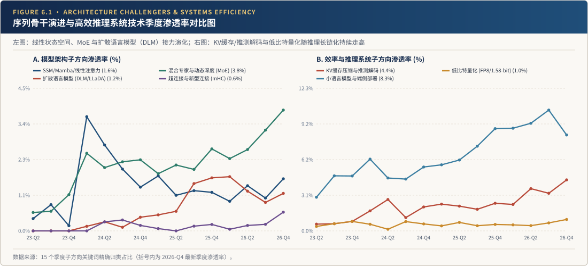

# 第 6 章 序列建模与模型架构演进：从 Transformer 垄断到混合状态空间、扩散语言模型与流形超连接

> **[LEARNING OBJECTIVES · 本章学习目标]**
> 1. 理解标准自回归 Transformer 在超长上下文与解码吞吐上的二次计算/显存瓶颈，以及线性注意力、状态空间模型（SSM/Mamba）与块保留网络（RetNet）的破局机理。
> 2. 掌握 2024–2026 年主流生产基座从“单一算子替代”走向“注意力 + SSM + 混合专家（MoE）+ 动态深度（MoD）”异构融合的工程逻辑。
> 3. 剖析离散扩散语言模型（Diffusion LLM，如 LLaDA）与后残差连接架构（流形约束超连接 mHC、注意力残差 AttnRes、循环隐推理网络）如何重构深度网络的拓扑连线。

---

## 6.1 不可兼得三角与亚二次序列建模的兴起

自 Vaswani 等人于 2017 年提出 Transformer 以来，缩放点积自注意力机制凭借训练阶段完全并行化与任意距离词元一步直达的全局感受野，统治了自然语言建模长达六年。然而当上下文窗口从 4K 迈向 128K、1M 乃至千万词元时，标准 Softmax 注意力暴露出尖锐的**“不可能三角”**矛盾：**训练并行性**、**推理常数级状态复杂度 $O(1)$** 与**精确长程联想召回（In-Context Recall）**难以兼得。

如图 6.1 左面板所示，2023 至 2026 年间序列骨干创新经历了清晰的三波浪潮：2023 年底至 2024 年初 SSM/线性注意力的陡峭冲顶、2024–2026 年混合专家（MoE）的持续攀升并确立统治地位，以及 2025–2026 年扩散语言模型（DLM）与超连接的异军突起。

<!-- AUTO-SYNC:START:domain_stats_Architecture -->

### 实证数据切片：架构创新与序列建模（跨年度演化指标与代表作）

| 统计维度 | 2023 | 2024 | 2025 | 2026 | 全周期开源率 |
| :--- | ---: | ---: | ---: | ---: | ---: |
| **主领域归档篇数** | 97 篇 | 220 篇 | 284 篇 | 270 篇 | 63.4% |
| **跨领域多标签渗透率** | 11.2% | 11.7% | 9.6% | 8.1% | — |

| 年份 | ArXiv | 本赛道高影响力里程碑论文 | 机构 | Upvotes |
| :--- | :--- | :--- | :--- | ---: |
| `2025-10-01` | [2509.26507](https://arxiv.org/abs/2509.26507) | [The Dragon Hatchling: The Missing Link between the Transform...](https://huggingface.co/papers/2509.26507) | Pathway | **547** |
| `2025-05-19` | [2505.09388](https://arxiv.org/abs/2505.09388) | [Qwen3 Technical Report](https://huggingface.co/papers/2505.09388) | Qwen | **338** |
| `2026-01-01` | [2512.24880](https://arxiv.org/abs/2512.24880) | [mHC: Manifold-Constrained Hyper-Connections](https://huggingface.co/papers/2512.24880) | DeepSeek | **318** |
| `2025-01-15` | [2501.08313](https://arxiv.org/abs/2501.08313) | [MiniMax-01: Scaling Foundation Models with Lightning Attention](https://huggingface.co/papers/2501.08313) | — | **300** |
| `2025-06-17` | [2506.13585](https://arxiv.org/abs/2506.13585) | [MiniMax-M1: Scaling Test-Time Compute Efficiently with Light...](https://huggingface.co/papers/2506.13585) | — | **273** |
| `2026-02-05` | [2602.04705](https://arxiv.org/abs/2602.04705) | [ERNIE 5.0 Technical Report](https://huggingface.co/papers/2602.04705) | — | **263** |

<!-- AUTO-SYNC:END:domain_stats_Architecture -->

### 6.1.1 从 RWKV、RetNet 到 Mamba：给固定维度状态装上“输入选择门”

早期线性注意力与线性时间不变（LTI）状态空间模型虽然将每步解码缓存压缩为固定大小的隐状态向量，但由于状态衰减率与输入投影与当前词元内容无关，模型无法决定“记住关键实体、丢弃填充废话”。2023 年底 **Mamba** 的突破正在于将离散化步长 $\Delta_t$ 与投影矩阵 $B_t, C_t$ 改造为输入 $x_t$ 的函数，使递归状态具备内容感知门控，并借助 GPU 片上 SRAM 并行前缀扫描（Parallel Associative Scan）避开显存读写瓶颈。

然而 2024 年的一系列机理剖析（如 *Linear Transformers with Learnable Kernel Functions* 及多查询关联召回 MQAR 测试）很快揭示了纯固定维度递归状态的香农信息论上限：**一个固定字节数的压缩状态无论如何门控，都不可能无损记住百万词元前任意位置的精确电话号码（大海捞针任务）**。

---

## 6.2 架构战争的和解：异构混血（Hybridization）与稀疏专家扩容（MoE/MoD）

既然全注意力拥有无损键值检索字典却显存昂贵，而 Mamba/线性注意力拥有极低成本压缩状态却欠缺精确抄写能力，最优雅的工程答案并非二选一，而是**按层比例混排**。

> **[KEY CONCEPT · 核心概念]** **异构混合骨干（Hybrid Backbone: Attention + SSM/Linear + MoE）**
> 以 **Jamba**（2024）、**MiniMax-01/M1**（2025，采用每 7 层闪电线性注意力搭配 1 层全 Softmax 注意力）及 Qwen3-Next / Kimi Linear 等为代表，现代工业级基座普遍采用“主体层使用线性注意力或 Mamba 承担局部语法与压缩记忆 + 稀疏间隔的全注意力层负责精确全局检索 + 前馈层替换为细粒度混合专家（Fine-Grained MoE）”的三明治架构。这一设计在保持与纯 Transformer 等效大海捞针准确率的同时，将百万词元推理的 KV 缓存与解码延迟削减 70%–85%。

与此同时，2024 年两篇颠覆直觉的实证分析改写了人们对“深度”的理解：
- *The Unreasonable Ineffectiveness of the Deeper Layers* 与 *Your Transformer is Secretly Linear* 发现传统 Pre-Norm 深层网络后半段层间表征高度近似线性变换，存在惊人的层间同质化稀释；
- 由此催生了沿计算图纵向做动态稀疏化的两条路线：一是 **Mixture-of-Depths（MoD）** 与 **MoDA（Mixture-of-Depths Attention，2026）**，让简单连接词直接绕过昂贵层计算；二是 **循环/递归微网络（Looped LMs / Tiny Recursive Networks，2025）**，固定少量参数层而在深度时间轴上反复循环迭代，用参数复用换取深层非线性逻辑深度。

---

## 6.3 打破最后两块教条：扩散语言模型（DLM）与流形约束超连接（mHC）

到了 2025 下半年至 2026 年，架构研究者向自回归 Transformer 最后两块“神圣不可侵犯”的假设发起了冲击：

1. **打破“从左到右逐词自回归”——离散扩散语言模型（Diffusion LLM）**
   自回归解码本质上是串行的，且受困于“逆向诅咒（Reversal Curse）”与全局结构规划短视。以 **LLaDA** 与 **LLaDA2.0-Uni**（2026）为代表的掩码离散扩散大模型，从全掩码序列出发通过双向注意力并行去噪恢复词元，天然支持任意顺序填空、双向全局一致性规划以及步数可控的并行解码，并在 2026 年配合 **DTCA** 跑通了扩散强化学习闭环。
2. **打破“恒等累加残差连接”——流形约束超连接（mHC）与注意力残差（AttnRes）**
   自 2015 年 ResNet 以来，$x_{l+1} = x_l + \mathcal{F}_l(x_l)$ 一直是所有深度网络的默认骨架，但它强迫所有历史层输出以固定权重 1 线性叠加，导致深层特征范数膨胀与所谓“PreNorm 稀释”。DeepSeek 于 2026 年初提出的 **mHC** 将单路残差扩展为多通道超连接流，并巧妙引入双随机矩阵流形投影（Sinkhorn-Knopp 约束），既保留跨百层恒等信号传播的数值稳定性，又允许不同层在不同特征子通道上自由交换信息；Moonshot 的 **Attention Residuals** 则进一步让每一层通过轻量级深度注意力动态检索任意前驱层的表征。

> **[LANDMARK STUDY · 里程碑论文精读]** **mHC: Manifold-Constrained Hyper-Connections (ArXiv: 2512.24880 · DeepSeek · 2026-01 · 318 Upvotes)**
> - **核心观点**：传统单流残差限制了跨层表征带宽，而朴素可学习超连接在大规模预训练中会破坏恒等映射守恒性引发灾难性数值发散；将超连接矩阵约束在双随机流形（Birkhoff 多胞体）上可兼得表达力与超大规模稳定性。
> - **方法与实验**：通过 Sinkhorn 迭代将残差混合矩阵投影至非负且行列和均为 1 的双随机流形，并定制融合通信与重计算算子以消除多流显存带宽开销，在数十亿至百亿级语言模型预训练上系统对比标准残差与无约束 HC。
> - **实验结论**：mHC 完全消除了大规模训练后期的损失尖峰（Loss Spikes），在仅增加极小算力开销的前提下，跨语言建模、数学与代码推理基准取得一致且随规模稳步扩大的显著增益。
> - **核心启示**：十年未变的残差跨层拓扑首次在工业级大模型预训练尺度上迎来了真正稳健的上位替代方案。

---

## 6.4 本章小结（Chapter Summary）

- 序列架构在四年间完成了“二元对立 → 异构混血 → 跨层与解码范式再造”的螺旋上升：纯架构论文占比虽从约 21% 温和收敛至 17%，但单篇含金量与硬件协同深度显著提高。
- 细粒度混合专家（MoE）+ 混合线性/全局注意力已成为百亿至万亿级基座的工业标准配置；而离散扩散大模型（DLM）、递归循环网络与流形超连接（mHC）则构成了下一代非传统基座的三大前沿支点。

---

## 6.5 思考与前沿研讨问题（Review & Research Questions）

1. **信息论边界**：请从状态向量自由度角度推导，为什么纯循环状态空间模型（无任何显式外部 KV 槽）在精确键值拷贝（Associative Recall）任务上的容量必然受限于隐状态维度 $d_{\text{state}}$？
2. **PreNorm 稀释效应**：分析标准 Pre-LayerNorm 残差网络随着层数 $L$ 增大，顶层残差流方差增长对新层更新相对幅度的抑制机制，并对比 mHC 与 Attention Residuals 各自的化解思路。
3. **自回归 vs 离散扩散**：在代码生成、结构化规划与实时流式对话三类不同场景下，离散扩散语言模型（DLM）相比自回归模型分别有哪些天然优势与延迟短板？
