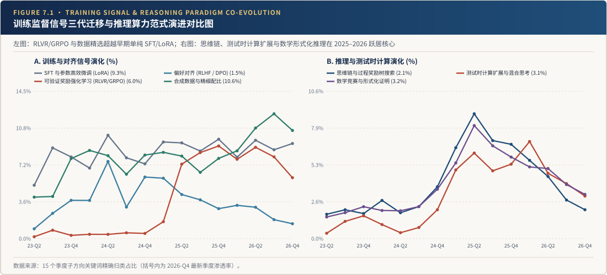

# 第 7 章 训练范式、强化学习与数据工程：从 SFT/DPO 到 RLVR、多奖励解耦与手术刀式数据精选

> **[LEARNING OBJECTIVES · 本章学习目标]**
> 1. 系统梳理 2023–2026 年大模型训练信号的三次历史性跃迁：**监督微调（SFT/LoRA）→ 离线偏好对齐（DPO）→ 可验证奖励强化学习（RLVR/GRPO/GSPO/GDPO/FIPO）**。
> 2. 理解为什么强化学习正在从“后训练末端修补”全面前移至**强化预训练（RPT）**、横向扩展至**离散扩散模型信用分配（DTCA）**，并走向**去中心化群体经验共享（Swarm RL）**。
> 3. 掌握当代数据工程的核心法则：从“全网海量爬取”转向**词元级选择性训练（Rho-1）**、**空白提示自提取（Magpie）**、**特征空间多样性合成**与**原则性预训练数据精选（OPUS）**。

---

## 7.1 四年三次换挡：训练监督信号的演进主线

纵观全库 18,000 余篇文献，**后训练、强化学习与数据工程**（`Training & RL`）是贯穿四年体量最庞大、渗透率最高（多标签占比始终高达 **30.6%–39.3%**）的核心发动机。如图 7.1 左面板所示，训练范式的内部主角每隔一年便发生一次深刻更替。

<!-- AUTO-SYNC:START:domain_stats_Training_RL -->

### 实证数据切片：后训练、强化学习与数据工程（跨年度演化指标与代表作）

| 统计维度 | 2023 | 2024 | 2025 | 2026 | 全周期开源率 |
| :--- | ---: | ---: | ---: | ---: | ---: |
| **主领域归档篇数** | 216 篇 | 471 篇 | 858 篇 | 920 篇 | 59.2% |
| **跨领域多标签渗透率** | 21.6% | 21.8% | 25.5% | 25.0% | — |

| 年份 | ArXiv | 本赛道高影响力里程碑论文 | 机构 | Upvotes |
| :--- | :--- | :--- | :--- | ---: |
| `2025-09-10` | [2509.08721](https://arxiv.org/abs/2509.08721) | [Sharing is Caring: Efficient LM Post-Training with Collectiv...](https://huggingface.co/papers/2509.08721) | Gensyn | **662** |
| `2025-01-23` | [2501.12948](https://arxiv.org/abs/2501.12948) | [DeepSeek-R1: Incentivizing Reasoning Capability in LLMs via ...](https://huggingface.co/papers/2501.12948) | DeepSeek | **442** |
| `2024-12-20` | [2412.15115](https://arxiv.org/abs/2412.15115) | [Qwen2.5 Technical Report](https://huggingface.co/papers/2412.15115) | — | **377** |
| `2026-02-11` | [2602.05400](https://arxiv.org/abs/2602.05400) | [OPUS: Towards Efficient and Principled Data Selection in Lar...](https://huggingface.co/papers/2602.05400) | Qwen | **347** |
| `2025-07-25` | [2507.18071](https://arxiv.org/abs/2507.18071) | [Group Sequence Policy Optimization](https://huggingface.co/papers/2507.18071) | Qwen | **319** |
| `2025-04-15` | [2504.10479](https://arxiv.org/abs/2504.10479) | [InternVL3: Exploring Advanced Training and Test-Time Recipes...](https://huggingface.co/papers/2504.10479) | — | **306** |

<!-- AUTO-SYNC:END:domain_stats_Training_RL -->

我们可以将这四年的训练方法论浓缩为四代目标函数的接力演进：

1. **第一代（2023）：最大似然模仿与低秩参数适配（SFT + LoRA/QLoRA）**
   核心假设是“只要收集或用 GPT-4 蒸馏足够多高质量问答对，通过交叉熵损失最大化目标序列似然，模型就能学会一切”。LIMA 进一步指出格式对齐仅需千级样本。然而纯粹 SFT 的天花板很快显现：模仿他人书写的静态答案容易导致分布外记忆过拟合（Memorization），模型知其然不知其所以然，且无法超越教师分布上限。
2. **第二代（2024）：隐式奖励重参数化与离线成对偏好优化（DPO 及其变体家族）**
   传统 RLHF 需维护策略、参考、奖励、价值四个大模型，工程极度脆弱。Rafailov 等提出的 **DPO** 利用最优策略与奖励函数的解析映射消除了显式奖励模型，配合 SimPO、ORPO、KTO 等改进引爆了 2024 上半年的对齐热潮（图 1.5 中 `24-Q2` 触及 7.6% 峰值）。但后续实证很快发现，离线 DPO 受限于静态偏好集的分布偏移（Off-Policy Shift），在多步数学、代码等硬核推理上提升有限。
3. **第三代（2025）：在线采样 + 组内相对优势 + 确定性可验证奖励（GRPO & RLVR）**
   DeepSeekMath 与 DeepSeek-R1 彻底扭转了风向：**放弃容易被“奖励黑客（Reward Hacking）”钻空子的神经网络打分器，回归数学真值匹配、编译器与单元测试通过率等零噪声可验证奖励（RLVR），配合无价值网络的在线群组采样（GRPO）**。模型第一次在没有人类示范思维过程的情况下，靠试错反馈自主进化出超越训练语料分布的深层求解策略。
4. **第四代（2025 下半年–2026）：序列级稳健优化、多奖励解耦、未来视野与跨模态 RL**
   随着 RLVR 推向千亿 MoE 基座、多目标智能体与非自回归扩散模型，研究者针对 GRPO 的痛点打出了一套精密组合拳：
   - **GSPO（Group Sequence Policy Optimization，`2507.18071`）**：以序列级似然几何均值替代词元级重要性采样比率，根治长链条与 MoE 专家切换引发的梯度爆炸；
   - **GDPO（Group reward-Decoupled Normalization Policy Optimization，NVIDIA，`2601.05242`）**：指出在同时优化准确率、格式、长度效率与安全性等多个奖励时，先求和再组内归一化会导致不同量纲奖励相互淹没，提出分奖励独立解耦归一化后再聚合优势；
   - **FIPO（Future-KL Influenced Policy Optimization，Qwen，`2603.19835`）**：引入未来步 KL 影响项以克服局部近视，定向激励跨越数千词元的深层策略转折；
   - **DTCA（Denoising Token Credit Assignment，`2610.35201`）**：将强化学习信用分配从自回归因果链推广至离散扩散语言模型的并行去噪步。

> **[KEY CONCEPT · 核心概念]** **同策略蒸馏（On-Policy Distillation）与弱驱动学习（Weak-Driven Learning）**
> 2026 年生产级模型（如 WeMM-Ecom、Qwen3.5 小尺寸系列）普遍采用“同策略蒸馏 + RL”混合配方：不再让学生模型死记硬背教师离线生成的固定文本，而是让学生模型按自身当前策略采样轨迹，再由教师模型在学生轨迹的每个状态上提供完整的对数几率分布（Logits）或纠偏引导，从根源上消除训练-推理暴露偏差（Exposure Bias）。而 *Weak-Driven Learning*（`2602.08222`）进一步揭示，引入异构弱模型的非对称探索反而能帮助强模型跳出模式坍缩。

---

## 7.2 数据工程的范式升维：从“泥沙俱下堆词元”到“外科手术式精选与合成”

如果说强化学习是引擎，那么数据治理便是决定上限的高辛烷值航空燃油。四年间，数据工程完成了三次认知升维：

- **从文档级清洗到词元级/特征空间精选**：2023–2024 年以 **FineWeb（15T tokens）** 为代表完成了文档级去重与启发式过滤标准化；**Rho-1** 证明仅训练信息增益高的关键少数词元即可大幅加速收敛；到了 2026 年，Qwen 发表 **OPUS**（`2602.05400`，347 赞），建立基于模型优化动态的预训练数据效用精确评估准则，而 *Less is Enough*（`2602.10388`，242 赞）则直接在 LLM 内部隐特征流形空间中进行最大化覆盖度的数据合成，以极小样本规模超越海量冗余合成集。
- **从静态问答合成到可执行交互轨迹合成**：2024 年的 **Magpie** 解决了单轮/多轮对话指令的无种子自提取；而 2026 年的 **Trajectory2Gym**（`2610.33568`）与 **DataFlex**（`2603.26164`）则将数据工程推向了“合成可交互决策环境与验证反馈闭环”的新纪元。

---

## 7.3 本章小结（Chapter Summary）

- 监督微调负责注入基础交互格式与认知模板（如 LIMO 仅用 817 条样本所示），而在线可验证强化学习（RLVR）负责重塑模型搜索空间、解锁自我纠错与分布外泛化。
- 从 GRPO 到 GSPO、GDPO、FIPO 与群体分布式 RL（Sharing is Caring），强化学习算法正变得愈发稳定、低显存开销且支持多目标协同。
- 数据工程已彻底告别“唯词元数量论”，进入以特征流形覆盖度、动态课程效用（OPUS）及可执行轨迹沙盒为核心的精密科学阶段。

---

## 7.4 思考与前沿研讨问题（Review & Research Questions）

1. **离线对齐 vs 在线探索**：从策略梯度期望分布的角度证明，为什么静态离线偏好数据集上的 DPO 训练在迭代后期容易出现被选（Chosen）与被拒（Rejected）对数概率同时下降的退化现象？
2. **多奖励耦合陷阱**：举例说明当“答案正确奖励（二值 0/1）”与“回答简短奖励（连续值）”直接相加后做组内标准差归一化时，为什么在某些采样组中模型会为了保住格式/长度分而放弃困难推理？GDPO 如何解决这一问题？
3. **无可验证真值场景的外推**：在创意写作、开放式商业咨询或科学假说提出（如 *AI Can Learn Scientific Taste*）等缺乏确定性编译器的开放域任务中，如何构造抗刷分的准可验证奖励信号（Unsupervised / Community-Grounded RLVR）？
