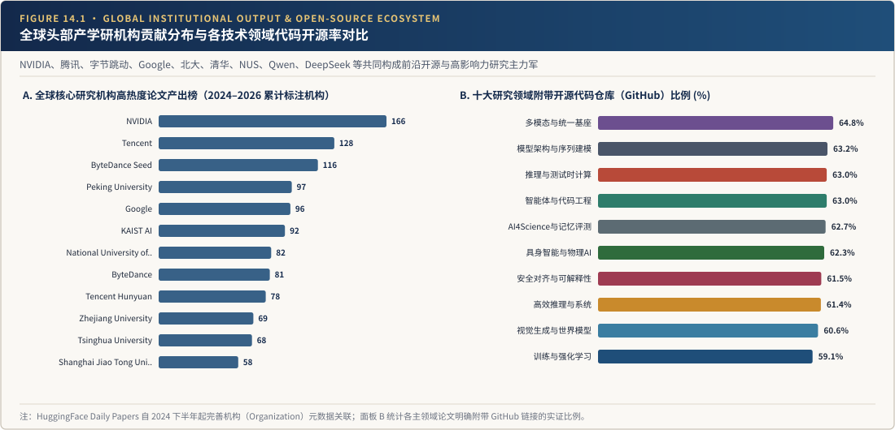

# 第 14 章 科学基础模型、持续长程记忆与全球开源生态格局

> **[LEARNING OBJECTIVES · 本章学习目标]**
> 1. 纵览 AI for Science（生命科学、材料化学、偏微分方程物理仿真、微观细胞世界模型与科学品味习得）四年间的跨学科融合脉络。
> 2. 理解突破固定上下文窗口限制的终极形态：**检索增强生成（RAG）→ 情节记忆与循环记忆槽（10M Haystack / PCM）→ 可组合持续学习与长程记忆（Composable Continual Learning）**。
> 3. 基于全库机构与开源链接实证数据（图 14.1），剖析全球顶尖产学研力量（NVIDIA、腾讯、字节跳动、Google、北大、清华、NUS、Qwen、DeepSeek、Meta 等）的协作竞争版图与开源民主化胜利。

---

## 14.1 科学智能（AI for Science）与长程记忆系统

在语言、代码与机器人之外，**科学智能、记忆系统与评测生态**（`Science, Memory & Eval`）累计贡献了逾 **2,200 篇**主领域论文（多标签占比稳定在 **30%** 左右），承载着人工智能改造自然科学发现范式与攻克灾难性遗忘两大使命。

<!-- AUTO-SYNC:START:domain_stats_Science_Eval -->

### 实证数据切片：科学智能、记忆系统与评测生态（跨年度演化指标与代表作）

| 统计维度 | 2023 | 2024 | 2025 | 2026 | 全周期开源率 |
| :--- | ---: | ---: | ---: | ---: | ---: |
| **主领域归档篇数** | 237 篇 | 488 篇 | 830 篇 | 650 篇 | 62.7% |
| **跨领域多标签渗透率** | 23.7% | 26.5% | 27.6% | 25.4% | — |

| 年份 | ArXiv | 本赛道高影响力里程碑论文 | 机构 | Upvotes |
| :--- | :--- | :--- | :--- | ---: |
| `2025-09-01` | [2508.18106](https://arxiv.org/abs/2508.18106) | [A.S.E: A Repository-Level Benchmark for Evaluating Security ...](https://huggingface.co/papers/2508.18106) | — | **349** |
| `2025-05-19` | [2505.09388](https://arxiv.org/abs/2505.09388) | [Qwen3 Technical Report](https://huggingface.co/papers/2505.09388) | Qwen | **338** |
| `2026-09-16` | [2609.06986](https://arxiv.org/abs/2609.06986) | [Continual Learning Mechanisms Compose for Long-Horizon Memor...](https://huggingface.co/papers/2609.06986) | Johns Hopkins Universi | **278** |
| `2025-08-22` | [2508.15763](https://arxiv.org/abs/2508.15763) | [Intern-S1: A Scientific Multimodal Foundation Model](https://huggingface.co/papers/2508.15763) | — | **270** |
| `2025-07-18` | [2507.13334](https://arxiv.org/abs/2507.13334) | [A Survey of Context Engineering for Large Language Models](https://huggingface.co/papers/2507.13334) | — | **261** |
| `2024-04-23` | [2404.14219](https://arxiv.org/abs/2404.14219) | [Phi-3 Technical Report: A Highly Capable Language Model Loca...](https://huggingface.co/papers/2404.14219) | Microsoft | **259** |

<!-- AUTO-SYNC:END:domain_stats_Science_Eval -->

### 14.1.1 从单模态方程求解到多基座协同科学发现
- **物理场与微观生命模拟**：从 2023 年 **PDE-Refiner** 精确长时程求解偏微分方程，到 2025 年多模态科学旗舰 **Intern-S1**（`2508.15763`，270 赞），再到 2026 年将视频世界模型引入细胞分裂、细菌游动与分子动力学的 **MicroVerse**（`2603.00585`），生成式模型正在成为跨尺度自然现象的数字显微镜。
- **异构科学基座协作与科学品味**：2026 年 UIUC 提出的 *Heterogeneous Scientific Foundation Model Collaboration*（`2604.27351`）打通蛋白质、小分子、基因组与文献大模型之间的异构表征协作；而 OpenMOSS 的 *AI Can Learn Scientific Taste*（`2603.14473`）则将 AI 在科研中的角色从“实验执行工”提升至“高影响力科学问题鉴别与提出者”。

### 14.1.2 跨越千万词元与跨月交互：长程持续记忆的演进
无论上下文窗口扩展到 128K 还是 1M，有限静态窗口终究无法承载伴随用户数月乃至数年的持续学习需求：
- **从朴素分块 RAG 到自省图检索与百万级循环记忆**：2023 年 **Self-RAG** 让模型学会按需检索与自我核验；2024 年 **BABILong**（*In Search of Needles in a 10M Haystack*）实证指出传统 RAG 在跨长文档分布式事实拼图任务上超过 $10^4$ 元素便严重失灵，而结合循环记忆增强可将有效信息整合跨度推至 **$10^7$（千万级）**词元；
- **2026 持续学习机制的正交可组合性**：约翰·霍普金斯大学在 2026 年 9 月高赞力作 *Continual Learning Mechanisms Compose for Long-Horizon Memorization*（`2609.06986`，278 赞）中系统证明，参数空间正则、情景回放缓冲与动态键值记忆槽并非互斥替代关系，而是具备数学与工程上的**正交可组合性（Composability）**，组合部署可在超长周期交互中大幅压低遗忘斜率。

---

## 14.2 全球开源共同体的伟大胜利与产学研版图

回望 2023 年初，业界普遍悲观地认为：受制于万卡集群与闭源商业飞轮，开源模型将永久落后闭源最前沿 18–24 个月。然而本仓库四年全量数据记录了一场波澜壮阔的**开源逆袭史**：

观察图 14.1 的双面板统计，可以清晰读出当代全球人工智能研究的生态结构特征：

1. **全领域高达 59%–65% 的代码开源率**：无论是多模态与统一基座（**64.8%** 附带 GitHub 仓库）、模型架构（**63.2%**）、推理与测试时计算（**63.0%**）、自主智能体（**63.0%**）还是具身物理 AI（**62.3%**），超过六成入选 Daily Papers 的工作同步公开了实现代码或模型权重。从 **FineWeb**（开源 15T 预训练数据）、**Molmo/PixMo**、**OpenCoder**、**SmolLM2** 到 2026 年的 **OpenSeeker**（完全开源前沿搜索智能体权重与合成数据）与 **ZGCM-1**（`2609.13356`，全开源数学与搜索基座），“真开源（Open Weights + Open Data + Open Recipe）”已成为赢得学术声誉的最高勋章。
2. **多元竞合的全球头部产学研矩阵**：
   在 2024–2026 年明确标注所属机构的论文产出榜上，**NVIDIA**（在算子系统、多奖励强化学习 GDPO、具身仿真与合成数据全线发力，2026 单年超百篇位居榜首）、**Tencent / Tencent Hunyuan**、**ByteDance / ByteDance Seed**、**Google**、**Qwen（阿里通义）**、**DeepSeek**、**AI at Meta**、**Microsoft Research** 等工业界实验室，与 **北京大学（Peking University）**、**KAIST AI**、**新加坡国立大学（NUS）**、**浙江大学**、**清华大学**、**上海交通大学** 等顶尖高校形成了紧密咬合的双引擎格局：高校在具身灵巧控制、新颖评测基准（如 WorldLeague、Video-MME）与机理批判性分析上保持极高敏锐度，工业界研究团队则在万亿词元预训练、大规模 RLVR 基座与系统级推理引擎上持续输出开源基础设施。

---

## 14.3 全书结语：站在 2026 年末望向下一个四年

合上这横跨 920 余个日夜、逾 18,000 篇论文的漫长画卷，我们看到人工智能已经走完了从**“模仿人类语言的统计鹦鹉（2023）”**、经由**“极致压缩与原生统一的多模态基座（2024）”**与**“在试错奖励中顿悟反思的逻辑思考者（2025）”**，进化为**“手握模块化技能与运行脚手架、在数字代码库与三维物理世界中自主闭环演化的行动主体（2026）”**的壮丽征程。

如果过去四年的桑基流向教会了我们一条最底层的经验法则，那就是：**每当某一项单点模型能力跨越可用阈值并沉淀为标准基础设施，创新的风暴眼就会立刻沿着系统耦合链条向更高维度的交互环境、更长周期的记忆闭环以及更严峻的可信治理边界迁徙。** 这部每日自动生长、自动重绘、自动编译的活体教材，将继续作为你的学术望远镜与航标图，记录下一个四年每一次范式潮汐的涨落。

---

## 14.4 思考与前沿研讨问题（Review & Research Questions）

1. **长上下文窗口 vs 持续记忆机制**：既然线性混合架构已能支持百万词元上下文，为什么在长周期科研助手与个人伴随智能体场景下，仍然必须引入权重级或结构化外部持续学习（Continual Learning）机制？
2. **真开源的三重维度**：比较“仅开放最终模型权重（Open Weights）”与“同时开放预训练/后训练数据精选管线及完整训练脚本（Fully Open Recipe，如 SmolLM2 / OpenSeeker / ZGCM-1）”对学术界开展机理可解释性与数据归因研究的不同价值。
3. **跨学科迁移思考**：回顾本教材梳理的十条核心技术脉络，哪一项在语言/代码领域率先跑通的范式（如 RLVR、Repo-To-Skill 或测试时搜索扩展）在你所处的具体工程或科研细分领域尚未被充分迁移落地？
